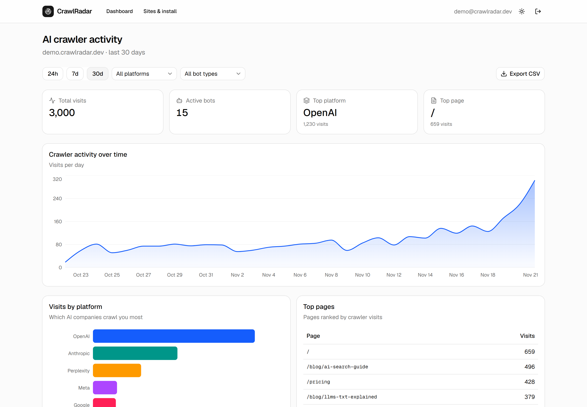
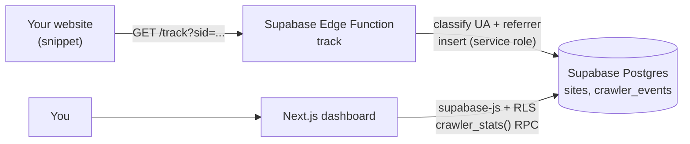

<div align="center">

# CrawlRadar

**Open-source AI crawler analytics.**
See which AI bots (GPTBot, ClaudeBot, PerplexityBot and more) visit your site, which pages they read, and how often.

[](https://github.com/JohnAdib/CrawlRadar/actions/workflows/ci.yml)
[](LICENSE)


<picture>
  <source media="(prefers-color-scheme: dark)" srcset="docs/images/dashboard-dark.png">
  
</picture>

</div>

## Why

Traditional analytics tools hide bot traffic, but AI platforms now read the web constantly, to train models, power AI search, and answer user questions in real time. CrawlRadar shows you that activity: which AI companies crawl you, what they read, how it trends, and which visitors arrive from ChatGPT, Perplexity or Claude.

## Features

- **Tiny tracking snippet**: a few hundred bytes, async, no dependencies. A `<noscript>` pixel also counts crawlers that never run JavaScript.
- **Bot detection and classification**: A curated list of known AI crawlers, grouped by platform (OpenAI, Anthropic, Google, Perplexity, Meta, Apple...) and type (training, search, assistant). Unknown self-declared bots are flagged as `Unknown`.
- **AI referrals**: humans who click through from ChatGPT, Perplexity, Claude, Gemini, Copilot and others.
- **Dashboard**: 24h / 7d / 30d ranges, platform and bot-type filters, activity timeline, platform breakdown, top pages, bot list, and recent activity log.
- **CSV export** of the current view or a site's full history.
- **Multi-site and private by default**: Supabase Auth, with Postgres row-level security so users only ever see their own data. IPs are stored as a daily-salted hash, never raw.

## How it works



1. The snippet requests `functions/v1/track` with the site ID, page URL and referrer. Crawlers that skip JavaScript load the `<noscript>` image instead.
2. The `track` function reads the **User-Agent from the request header** (so a page can't fake it), classifies it, and stores only AI crawler hits and AI referrals. Ordinary human visits are dropped.
3. The dashboard reads Postgres directly through supabase-js. RLS scopes every query to the signed-in user, and a single `crawler_stats()` SQL function returns all chart data in one round trip. There's no separate API server to run.

## Quick start (local, about 5 minutes)

**Prerequisites:** [Node.js 24+](https://nodejs.org), [pnpm](https://pnpm.io) and [Docker](https://www.docker.com/) (for the local Supabase stack).

```bash
git clone https://github.com/JohnAdib/CrawlRadar.git
cd CrawlRadar
pnpm install

pnpm db:start                                  # local Supabase: Postgres, Auth, Edge Functions, Studio
cp apps/web/.env.example apps/web/.env.local   # local defaults already filled in
pnpm dev                                       # http://localhost:3000
```

Sign in with the seeded demo account: **`demo@crawlradar.dev` / `crawlradar-demo`**. It comes with 30 days of sample data.

To see live data arrive, create your own account, add a site, and send simulated crawler hits:

```bash
pnpm simulate <site-id>      # site ID is shown on the "Sites & install" page
```

| URL | What |
| --- | --- |
| http://localhost:3000 | Dashboard |
| http://127.0.0.1:54323 | Supabase Studio (browse tables) |
| http://127.0.0.1:54321/functions/v1/track | Tracking endpoint |

<details>
<summary>Useful commands</summary>

| Command | Does |
| --- | --- |
| `pnpm dev` | Run the dashboard in dev mode |
| `pnpm build` | Production build |
| `pnpm lint` / `pnpm typecheck` | ESLint / TypeScript across the workspace |
| `pnpm test` | Unit tests (bot classifier, CSV writer) |
| `pnpm format` | Prettier |
| `pnpm db:start` / `pnpm db:stop` | Start / stop local Supabase |
| `pnpm db:reset` | Re-apply migrations and the demo seed |
| `pnpm simulate <site-id> [count] [track-url]` | Send test crawler hits |

</details>

## Install the snippet on your site

Add a site on **Sites & install** and copy the two generated snippets:


```html
<!-- 1. In <head> -->
<script>
(function(d,s){var g=d.createElement("script");g.async=1;
g.src="https://<project>.supabase.co/functions/v1/track?sid="+s+"&u="+encodeURIComponent(location.href)+"&r="+encodeURIComponent(d.referrer);
d.head.appendChild(g)})(document,"<site-id>");
</script>

<!-- 2. Right after <body>: counts crawlers that don't run JavaScript -->
<noscript>.supabase.co/functions/v1/track?sid=<site-id>&t=img" alt="" width="1" height="1" style="position:absolute;left:-9999px"></noscript>
```

The site card shows **"Last hit ..."** as soon as the first event lands.

## Deploy

### 1. Supabase (database, auth, tracking function)

Create a free project at [supabase.com](https://supabase.com), then:

```bash
pnpm exec supabase login
pnpm exec supabase link --project-ref <your-project-ref>
pnpm exec supabase db push                                  # apply migrations (the demo seed is local-only)
pnpm exec supabase functions deploy track --no-verify-jwt   # public endpoint: crawlers have no JWT
pnpm exec supabase secrets set IP_HASH_SALT="$(openssl rand -hex 32)"
```

In **Authentication > URL Configuration**, set the Site URL to your dashboard's URL.

### 2. Dashboard (Vercel or any Node host)

[](https://vercel.com/new/clone?repository-url=https%3A%2F%2Fgithub.com%2FJohnAdib%2FCrawlRadar&root-directory=apps%2Fweb&env=NEXT_PUBLIC_SUPABASE_URL,NEXT_PUBLIC_SUPABASE_PUBLISHABLE_KEY)

Set **Root Directory** to `apps/web` and add two environment variables from **Project Settings > API**:

| Variable | Value |
| --- | --- |
| `NEXT_PUBLIC_SUPABASE_URL` | `https://<project-ref>.supabase.co` |
| `NEXT_PUBLIC_SUPABASE_PUBLISHABLE_KEY` | the publishable (anon) key |

The service-role key lives only inside the Edge Function. The dashboard never needs it.

## Project structure

```
apps/web/                 Next.js 16 dashboard (App Router, Server Components, Server Actions)
  app/(app)/              signed-in pages: dashboard, sites & install
  app/login/              sign in / sign up
  app/export/route.ts     CSV export
  proxy.ts                session refresh + auth gate
packages/ui/              @crawlradar/ui: shadcn/ui design system (components, charts, theme)
packages/eslint-config/   shared lint config
packages/typescript-config/
supabase/
  migrations/             schema, RLS policies, crawler_stats() function
  functions/track/        tracking endpoint (Deno)
  functions/_shared/      bot + referrer classifier and its tests
  seed.sql                local demo user and 30 days of sample data
scripts/simulate-bots.ts  send test crawler hits
```

## Adding a bot

Add one line to `BOT_PATTERNS` in [`supabase/functions/_shared/bots.ts`](supabase/functions/_shared/bots.ts) and a case in `bots.test.ts`, then run `pnpm test`. The [Dark Visitors](https://darkvisitors.com/agents) list is a good reference for new agents. Pull requests are welcome.

## Design decisions

| Decision | Why | Considered instead |
| --- | --- | --- |
| Snippet's own GET request is the beacon | One request, no CORS preflight, and the server reads the real User-Agent header | `fetch`/`sendBeacon` POST with a JS-reported UA, which is spoofable and needs an extra request |
| `<noscript>` pixel fallback | Most AI crawlers don't execute JavaScript, so a JS-only tracker misses them | JS only (misses most crawlers); server log ingestion (planned) |
| Store only AI hits and referrals | Keeps the free tier small and avoids storing personal browsing data | Store everything and filter at query time |
| Daily-salted SHA-256 IP hash | Lets you group visits within a day without storing an IP or tracking across days | Raw IP; a static hash (reversible by brute force over IPv4) |
| No custom API: supabase-js + RLS + one SQL RPC | Less code to run and secure; authorisation is enforced in the database | Express/Hono API layer; client-side aggregation (breaks past 1,000 rows) |
| Monorepo with a shared `@crawlradar/ui` package | shadcn's official monorepo layout; leaves room for `apps/api` or a docs site | Single app (simpler today, harder to grow) |

## Limitations

- **JavaScript and pixel tracking only sees crawlers that fetch your HTML and its resources.** Bots that read raw HTML without loading `<script>` or `` resources are invisible. Server-side tracking (edge middleware or log ingestion) is the planned fix.
- **`Google-Extended` and `Applebot-Extended` are robots.txt tokens.** Google and Apple crawl with their normal Googlebot and Applebot user agents, so these two rarely appear in real traffic. They're still matched in case a request does carry them.
- **Site IDs are public.** Someone who copies your snippet could send fake events. Domain or Origin checks and rate limiting are on the roadmap.
- **Volume:** fine for small and medium sites on Supabase's free tier. High-traffic sites should add table partitioning or a rollup table.

## Roadmap

- [ ] Server-side tracking (Next.js / Cloudflare middleware, log file import)
- [ ] Origin/domain verification and rate limiting on `/track`
- [ ] Daily rollup table for large sites
- [ ] robots.txt checker: which AI bots you allow or block
- [ ] Email digests and alerts

## Contributing

Contributions are welcome. See [CONTRIBUTING.md](CONTRIBUTING.md).

## License

[MIT](LICENSE) © MrAdib
