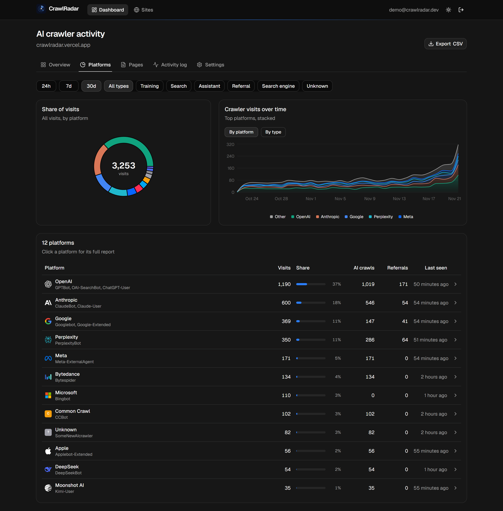
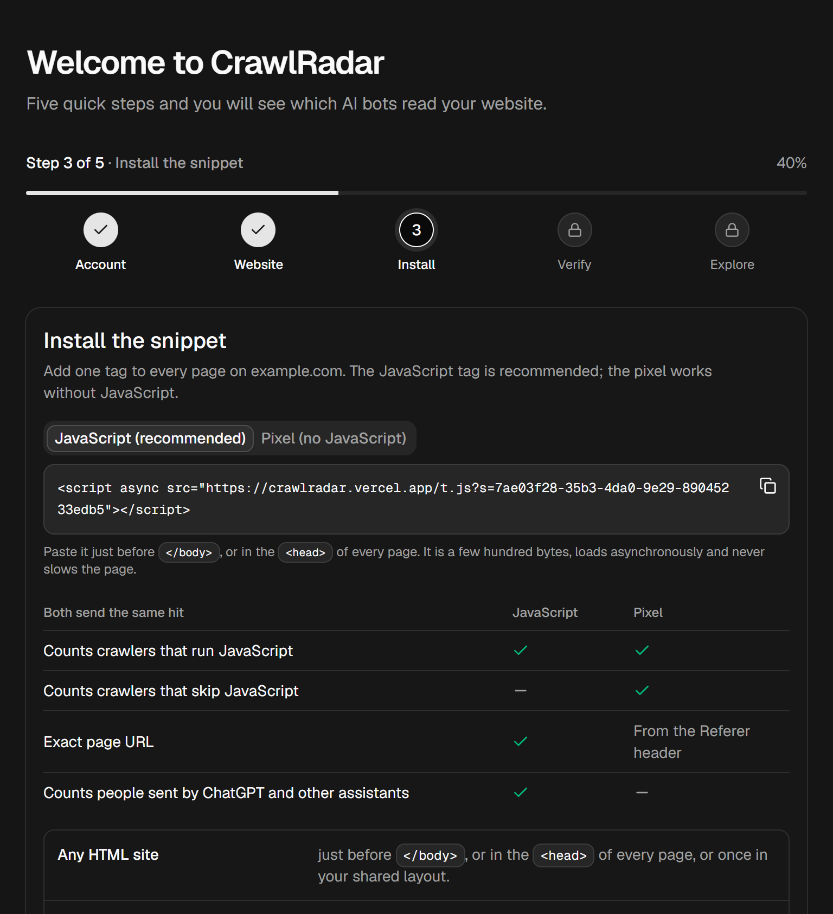
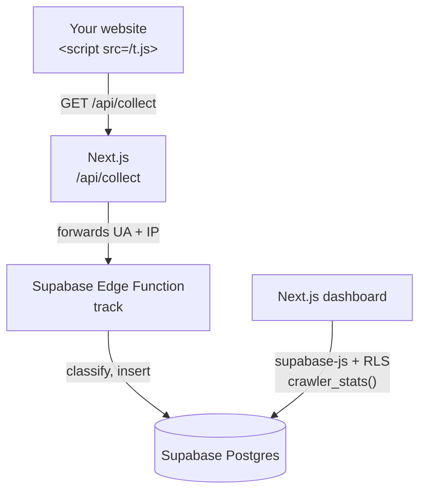
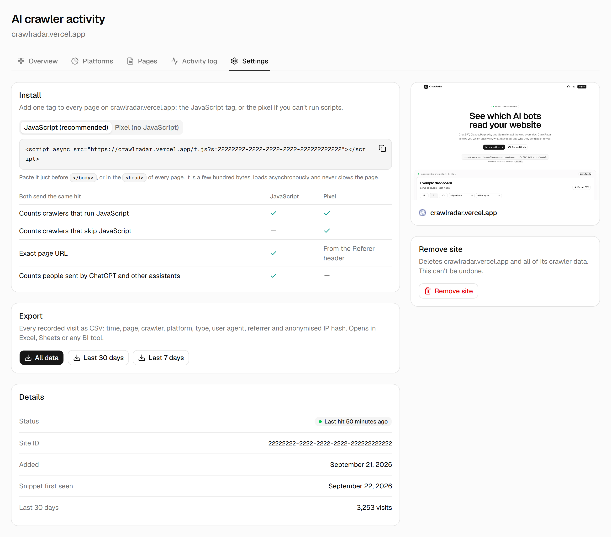

<div align="center">

# CrawlRadar

**Open-source analytics for the AI web.**
See which AI crawlers (GPTBot, ClaudeBot, PerplexityBot and more) read your site, what they read, and how many people AI assistants send back to you.

[](https://github.com/JohnAdib/CrawlRadar/actions/workflows/ci.yml)
[](#testing)
[](LICENSE)
[](https://biomejs.dev)


**[Try the live demo](https://crawlradar.vercel.app/#demo)** · [Quick start](#quick-start) · [Deploy](#deploy) · [Requirements](docs/PRD.md)

<picture>
  <source media="(prefers-color-scheme: dark)" srcset="docs/images/dashboard-dark.png">
  
</picture>

</div>

## Why

Regular analytics tools filter bots out. But AI platforms now read the web around the clock: to train models, to power AI search, and to answer questions in real time. CrawlRadar does the opposite of normal analytics. It shows you exactly that traffic, so you know how visible you are to AI, and which assistants send real people your way.

## Features

- **One-line install, two ways.** An async `<script>` tag (about 400 bytes, never blocks the page) or a plain pixel for sites and crawlers without JavaScript. Paste it just before `</body>`, or in the `<head>`.
- **Guided onboarding.** Five locked steps (account, website, install, verify, explore) with a progress tracker and install tips for WordPress, Shopify, Webflow and frameworks. The dashboard unlocks once the snippet is seen working.
- **Every AI crawler, classified.** 60+ AI bots grouped by platform and purpose (training, search, assistant), cross-checked with the community [ai.robots.txt](https://github.com/ai-robots-txt/ai.robots.txt) list. That includes Chinese AI platforms: DeepSeek, Qwen and Tongyi (Alibaba), Kimi (Moonshot AI), Doubao (Bytedance), ERNIE (Baidu), Hunyuan (Tencent) and ChatGLM (Zhipu AI). Any other bot is caught by [isbot](https://github.com/omrilotan/isbot) and flagged `Unknown`, named from its user agent.
- **Search engines alongside.** Googlebot, Bingbot, Baiduspider, YandexBot and others are recorded as their own type, and kept out of the AI totals.
- **AI referrals.** Count the people who click through from ChatGPT, Perplexity, Claude, Gemini, Copilot, Grok, DeepSeek, Kimi, Qwen and more.
- **Five views, as in the [requirements](docs/PRD.md):**
  - **Overview:** visits and referrals against the previous period, traffic by platform or by type, a weekday × hour heatmap, top pages, platforms, crawlers and the latest visits
  - **Platforms:** share of visits, traffic per platform over time, and every platform with its crawlers
  - **Pages:** every crawled page ranked and searchable; any page opens its own report
  - **Activity log:** every visit with its user agent and referrer, filterable and paginated
  - **Settings:** the snippet, CSV export and the site itself
- **Filters and export.** 24h / 7d / 30d ranges, platform and bot-type filters kept in the URL, and CSV export (written with [PapaParse](https://www.papaparse.com/)) of the current view or a site's full history.
- **Polished details.** Animated empty states, loading states, interactive sparklines, light and dark mode, and a layout built for phones.
- **Private and multi-tenant.** Supabase Auth plus Postgres row-level security, so users only ever see their own data. IPs are stored as a daily-salted hash, never raw.

<table>
  <tr>
    <td></td>
    <td></td>
  </tr>
</table>

## How it works



1. **Collect.** Your site loads `/t.js` from your CrawlRadar domain. It sends the page URL and referrer to `/api/collect` on the same domain, so customers never see a backend URL.
2. **Classify.** `/api/collect` forwards the visit, with the visitor's real User-Agent and IP, to the `track` Edge Function. The function classifies it from the request header (page script can't fake it) and stores only bot hits and AI referrals. Ordinary human visits are dropped; the first one from the site's own pages only marks the snippet as installed, which completes onboarding.
3. **Report.** The dashboard reads Postgres directly through supabase-js. RLS scopes every query to the signed-in user, and one `crawler_stats()` SQL function returns every chart's data in a single round trip. There's no separate API server.

## Quick start

**You need:** [Node.js 24+](https://nodejs.org) and pnpm. If you don't have pnpm, run `corepack enable` once.

The dashboard is plain Node.js. The only other piece is a Supabase backend. Choose one:

|           | Option A: Supabase Cloud                            | Option B: fully local              |
| --------- | --------------------------------------------------- | ---------------------------------- |
| Needs     | A free [supabase.com](https://supabase.com) account | [Docker](https://www.docker.com/)  |
| Demo data | No (send test hits instead)                         | Yes, 60 days preloaded             |
| Best for  | Trying it fast, or deploying                        | Offline development, running tests |

First, get the code:

```bash
git clone https://github.com/JohnAdib/CrawlRadar.git
cd CrawlRadar
pnpm install
```

### Option A: Supabase Cloud (no Docker)

1. Create a free project at [supabase.com/dashboard/new](https://supabase.com/dashboard/new).

2. Log in and link the project:

   ```bash
   pnpm exec supabase login
   pnpm exec supabase link --project-ref <your-project-ref>
   ```

3. Create the tables and deploy the tracking function:

   ```bash
   pnpm exec supabase db push
   pnpm exec supabase functions deploy track --no-verify-jwt
   ```

4. Copy the env file:

   ```bash
   cp apps/web/.env.example apps/web/.env.local
   ```

   Then set the project URL and the publishable key in `apps/web/.env.local`, from **Project Settings > API**.

5. Start the dashboard:

   ```bash
   pnpm dev
   ```

6. Open http://localhost:3000, create an account and add a site. Then send test crawler hits:

   ```bash
   pnpm simulate <site-id> <your-domain> 40 https://<your-project-ref>.supabase.co/functions/v1/track
   ```

### Option B: fully local (Docker)

1. Start the local Supabase stack. It runs Postgres, Auth, the tracking function and Studio, and loads the demo data.

   ```bash
   pnpm db:start
   ```

2. Copy the env file. The local values are already filled in.

   ```bash
   cp apps/web/.env.example apps/web/.env.local
   ```

3. Start the dashboard:

   ```bash
   pnpm dev
   ```

4. Open http://localhost:3000 and sign in as **`demo@crawlradar.dev`** / **`crawlradar-demo`**.

Local URLs:

| URL                                       | What                            |
| ----------------------------------------- | ------------------------------- |
| http://localhost:3000                     | Home page and dashboard         |
| http://127.0.0.1:54323                    | Supabase Studio (browse tables) |
| http://127.0.0.1:54321/functions/v1/track | Tracking function               |

## Install the tracker on your site

Sign up and onboarding walks you through it: add your domain, add one tag to every page, and open your site once. The dashboard unlocks as soon as the tag reports in. Add more sites later from **Sites**; each one's tags, CSV export and removal live in the dashboard's **Settings** view.

There are two ways to install. Both send the same hit, so pick one.

**JavaScript (recommended).** Paste it just before `</body>`, or in the `<head>`, of every page:

```html
<script async src="https://<your-crawlradar>/t.js?s=<site-id>"></script>
```

**Pixel (no JavaScript).** Paste it just before `</body>` of every page:

```html
/api/collect?t=img&sid=<site-id>"
  alt=""
  width="1"
  height="1"
  style="position:absolute"
  referrerpolicy="no-referrer-when-downgrade"
/>
```

|                                                    | JavaScript | Pixel                   |
| -------------------------------------------------- | ---------- | ----------------------- |
| Counts crawlers that run JavaScript                | Yes        | Yes                     |
| Counts crawlers that skip JavaScript               | No         | Yes                     |
| Exact page URL                                     | Yes        | From the Referer header |
| Counts people sent by ChatGPT and other assistants | Yes        | No                      |

The PRD calls for a "tracking pixel (JS SDK)". The JavaScript tag is exactly that: about 400 bytes that send the visit as a 1×1 image request. The plain pixel is the same request without the script. To use both, wrap the pixel in `<noscript>` so visits aren't counted twice.

**Head or before `</body>`?** Either works, and `async` means the script never blocks rendering. Before `</body>` keeps the head clean; the head starts a little earlier. Both placements, and the pixel on its own, are covered by an end-to-end test that loads a real page as GPTBot and checks the visit arrives.

<picture>
  <source media="(prefers-color-scheme: dark)" srcset="docs/images/install-dark.png">
  
</picture>

The site shows **"Last hit ..."** with a live dot as soon as the first event lands. Until then the dashboard listens with a live empty state, then switches to charts on its own.

## Security and privacy

- **Accounts are isolated by the database itself.** Every query runs under Postgres row-level security as the signed-in user. Two people can add the same domain: each gets a separate site with a random ID, and neither can read, change or delete the other's data. [`security.test.sql`](supabase/tests/database/security.test.sql) proves this with 21 checks, and the end-to-end suite repeats it through the real app.
- **A copied snippet can't inject data.** Site IDs are visible in the snippet, so the tracking function only counts a hit when the page belongs to the site's domain (or a subdomain). Hits from anywhere else are dropped.
- **Nothing personal is stored.** Only bot hits and AI referrals are kept, IPs are stored as a SHA-256 hash with a salt that rotates daily, and the service-role key never leaves the Edge Function.
- **Shared links stay private.** A link to a private page sends signed-out visitors (and link-preview bots) to sign in. The preview describes the destination, like "AI crawler dashboard", without showing any data.
- **The install check is safe.** Onboarding can fetch a site's home page to look for the tag; it only fetches public hostnames (no localhost, private names or IP addresses), with a timeout and a size cap.
- **Site previews** on the Sites page come from public services (a screenshot from [Microlink](https://microlink.io) and a favicon from Google), which receive only the site's public domain name.

## Testing

| Suite                     | Command                     | What it covers                                                                                                                                                                                                                                                                                    |
| ------------------------- | --------------------------- | ------------------------------------------------------------------------------------------------------------------------------------------------------------------------------------------------------------------------------------------------------------------------------------------------- |
| Lint and format           | `pnpm lint` / `pnpm format` | Biome formatting, import order and lint rules, cognitive complexity of at most 10 per function, functions of at most 120 lines, and no hand-written source file over 200 lines                                                                                                                    |
| Unit (Vitest)             | `pnpm test`                 | Bot, search-engine and referrer classifier (every listed bot), stats engine, pages and platform tables, CSV writer, install check, filters, demo data, collect endpoint                                                                                                                           |
| Coverage                  | `pnpm test:coverage`        | 100% of statements, branches, functions and lines in that code. CI fails below 100%                                                                                                                                                                                                               |
| End-to-end (Playwright)   | `pnpm test:e2e`             | Onboarding (locked app, five steps, resume), every dashboard view, filters, reports, the endless activity log, both install methods, the theme switch, CSV export, site switching and removal, account isolation, snippet spoofing, the home page and its demo, social previews and phone layouts |
| Database security (pgTAP) | `pnpm db:test`              | Row-level security between accounts: two users with the same domain, cross-account reads, writes, renames, deletes and anonymous access                                                                                                                                                           |

End-to-end tests run against a production build and the local Supabase stack. Run `pnpm db:start` first.

### Storybook

Every app component (dashboard, onboarding, site settings, home sections) on the home page demo data, with a light/dark toggle in the toolbar. CI checks that it builds.

```bash
pnpm --filter @crawlradar/web storybook        # dev server on http://localhost:6006
pnpm --filter @crawlradar/web build-storybook  # static build in apps/web/storybook-static
```

## Deploy

### 1. Supabase

1. Do steps 1 to 3 of [Option A](#option-a-supabase-cloud-no-docker). The demo seed is never pushed to a hosted project.
2. Optionally, set your own salt for IP hashing. Without one, the function falls back to the service role key.

   ```bash
   pnpm exec supabase secrets set IP_HASH_SALT="$(openssl rand -hex 32)"
   ```

3. In **Authentication > URL Configuration**, set the Site URL to your dashboard's URL.

### 2. Dashboard (Vercel or any Node host)

[](https://vercel.com/new/clone?repository-url=https%3A%2F%2Fgithub.com%2FJohnAdib%2FCrawlRadar&root-directory=apps%2Fweb&env=NEXT_PUBLIC_SUPABASE_URL,NEXT_PUBLIC_SUPABASE_PUBLISHABLE_KEY)

Set **Root Directory** to `apps/web` and add two environment variables from **Project Settings > API**:

| Variable                               | Value                               |
| -------------------------------------- | ----------------------------------- |
| `NEXT_PUBLIC_SUPABASE_URL`             | `https://<project-ref>.supabase.co` |
| `NEXT_PUBLIC_SUPABASE_PUBLISHABLE_KEY` | the publishable key                 |

The service-role key lives only inside the Edge Function. The dashboard never needs it.

## Project structure

```
apps/web/                  Next.js 16 app (App Router, Server Components, Server Actions)
  app/page.tsx             home page with the interactive demo dashboard
  app/onboarding/          the five-step onboarding (the app is locked until it is done)
  app/(app)/dashboard/     Overview, Platforms, Pages, Activity log and Settings views
  app/(app)/sites/         all sites; /export streams CSV
  app/api/collect/         public collection endpoint, forwards to the track function
  components/dashboard/    one small component per panel, shared by the live app and the demo
  components/onboarding/   the stepper and each step
  components/home/         home page sections
  lib/stats/               stats engine (TypeScript twin of crawler_stats(), used by the demo)
  public/t.js              the tracker customers embed
  .storybook/              Storybook for the app's components (*.stories.tsx next to each one)
packages/ui/               @crawlradar/ui: shadcn/ui design system
supabase/
  migrations/              schema, RLS policies, crawler_stats(), crawler_pages()
  functions/track/         tracking function (Deno)
  functions/_shared/       classifier: AI bots, search engines, AI referrers, isbot fallback
  seed.sql                 local demo user and 60 days of data
e2e/                       Playwright tests
scripts/simulate-bots.ts   send test crawler hits
scripts/check-file-size.mjs  keeps every hand-written source file under 200 lines
docs/PRD.md                product requirements and implementation notes
```

## Adding a bot

Add one line to [`ai-bots.ts`](supabase/functions/_shared/ai-bots.ts) (or [`search-engines.ts`](supabase/functions/_shared/search-engines.ts)): the user-agent token, the platform and the type. `pnpm test` checks that every entry classifies to itself. [ai.robots.txt](https://github.com/ai-robots-txt/ai.robots.txt) and [Known Agents](https://knownagents.com/agents) track new agents. Pull requests are welcome.

## Design decisions

| Decision                                              | Why                                                                                                        | Considered instead                                                      |
| ----------------------------------------------------- | ---------------------------------------------------------------------------------------------------------- | ----------------------------------------------------------------------- |
| One `<script src>` tag on your own domain             | Shortest install, a cacheable static tracker, and customers only see your domain                           | Inline loader pointing at `*.supabase.co` (longer, exposes the backend) |
| `/api/collect` forwards to the Edge Function          | Ingest logic lives in one place, and the web host needs no service-role key                                | Inserting from a Next.js route (secret key in the web host)             |
| User-Agent read on the server, beacon via a GET pixel | No CORS preflight, and page script can't fake the UA                                                       | `fetch`/`sendBeacon` POST with a JS-reported UA                         |
| Only bot hits and referrals are stored                | Keeps the free tier small and avoids storing personal browsing data                                        | Store everything and filter at query time                               |
| A curated AI list, then `isbot` for any other bot     | Exact names, platforms and purposes for AI bots; a maintained library catches the rest                     | Only a generic bot/crawl/spider regex                                   |
| Onboarding unlocks on the first real hit              | Proves the install works end to end, with no test data written to the account                              | A send-test-event button (fake data in the dashboard)                   |
| Daily-salted SHA-256 IP hash                          | Groups visits within a day without storing an IP or tracking across days                                   | Raw IP; a static hash (reversible by brute force over IPv4)             |
| No custom API: supabase-js, RLS and one SQL function  | Less code to run and secure; authorisation enforced in the database                                        | A separate API server; client-side aggregation (breaks past 1,000 rows) |
| Stats engine mirrored in TypeScript                   | The home page demo runs the real dashboard on mock data, fully client-side, and the logic is unit-testable | A static screenshot                                                     |
| Monorepo with a shared `@crawlradar/ui`               | shadcn's official monorepo layout; room for `apps/api` or docs later                                       | A single app                                                            |

## Limitations

- **JavaScript tracking only sees crawlers that load your page's resources.** Bots that read raw HTML without loading `<script>` or `` are invisible. Server-side tracking (edge middleware or log import) is the planned fix.
- **`Google-Extended` and `Applebot-Extended` are robots.txt tokens.** Google and Apple crawl with their normal user agents, so these two rarely appear in real traffic.
- **Rate limiting.** The collection endpoint has no rate limit yet. Hits are only counted from the site's own domain, but a determined script could still send many from it.
- **Volume.** Fine for small and medium sites on Supabase's free tier. Large sites should add partitioning or a daily rollup table.

## Roadmap

- [ ] Server-side tracking (middleware and log import)
- [ ] Rate limiting on collection
- [ ] Daily rollup table for large sites
- [ ] robots.txt checker: which AI bots you allow or block
- [ ] Email digests and alerts

## Credits

Platform logos from [LobeHub Icons](https://github.com/lobehub/lobe-icons) (MIT). Theme toggle adapted from [Magic UI](https://magicui.design) (MIT). Animations with [Motion](https://motion.dev).

## Contributing

Contributions are welcome. See [CONTRIBUTING.md](CONTRIBUTING.md).

## License

[MIT](LICENSE) © MrAdib
