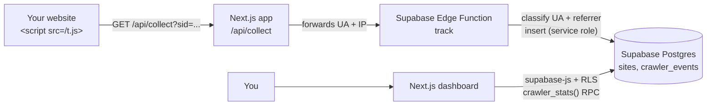
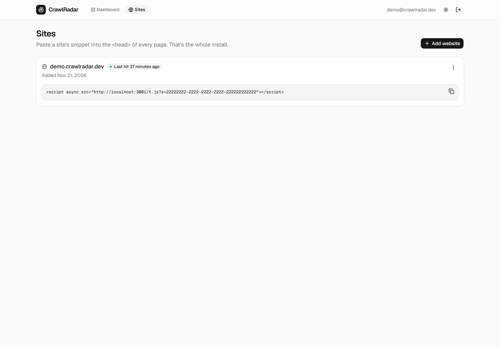

<div align="center">

# CrawlRadar

**Open-source AI crawler analytics.**
See which AI bots (GPTBot, ClaudeBot, PerplexityBot and more) visit your site, which pages they read, and how often.

[](https://github.com/JohnAdib/CrawlRadar/actions/workflows/ci.yml)
[](LICENSE)


**[Live app](https://crawlradar.vercel.app)** · [Quick start](#quick-start) · [Deploy](#deploy)

<picture>
  <source media="(prefers-color-scheme: dark)" srcset="docs/images/dashboard-dark.png">
  
</picture>

</div>

## Why

Traditional analytics tools hide bot traffic, but AI platforms now read the web constantly, to train models, power AI search, and answer user questions in real time. CrawlRadar shows you that activity: which AI companies crawl you, what they read, how it trends, and which visitors arrive from ChatGPT, Perplexity or Claude.

## Features

- **One-line install**: a single async `<script>` tag served from your own CrawlRadar domain. The tracker itself is about 400 bytes.
- **Bot detection and classification**: A curated list of known AI crawlers, grouped by platform (OpenAI, Anthropic, Google, Perplexity, Meta, Apple...) and type (training, search, assistant). Unknown self-declared bots are flagged as `Unknown`.
- **AI referrals**: humans who click through from ChatGPT, Perplexity, Claude, Gemini, Copilot and others.
- **Dashboard**: 24h / 7d / 30d ranges, platform and bot-type filters, activity timeline, platform breakdown, top pages, bot list, and recent activity log.
- **CSV export** of the current view or a site's full history.
- **Multi-site and private by default**: Supabase Auth, with Postgres row-level security so users only ever see their own data. IPs are stored as a daily-salted hash, never raw.

## How it works



1. The site loads `/t.js` from your CrawlRadar domain. It sends the page URL and referrer to `/api/collect` on the same domain, so your customers never see a Supabase URL.
2. `/api/collect` forwards the request, including the visitor's User-Agent and IP, to the `track` Edge Function. The function reads the **User-Agent from the request header** (so a page can't fake it), classifies it, and stores only AI crawler hits and AI referrals. Ordinary human visits are dropped.
3. The dashboard reads Postgres directly through supabase-js. RLS scopes every query to the signed-in user, and a single `crawler_stats()` SQL function returns all chart data in one round trip. There's no separate API server to run.

## Quick start

**You need:** [Node.js 24+](https://nodejs.org) and pnpm. If you don't have pnpm, run `corepack enable` once.

The dashboard is plain Node.js. The only other piece is a Supabase backend (Postgres, Auth and the tracking function). Pick one of these:

| | Option A: Supabase Cloud | Option B: fully local |
| --- | --- | --- |
| Needs | Free [supabase.com](https://supabase.com) account | [Docker](https://www.docker.com/) |
| Demo data | No (send test hits instead) | Yes, 30 days preloaded |
| Best for | Trying it quickly, or deploying | Offline development |

First, get the code:

```bash
git clone https://github.com/JohnAdib/CrawlRadar.git
cd CrawlRadar
pnpm install
```

### Option A: Supabase Cloud (no Docker)

1. Create a free project at [supabase.com/dashboard/new](https://supabase.com/dashboard/new).

2. Log in and link the project:

   ```bash
   pnpm exec supabase login
   pnpm exec supabase link --project-ref <your-project-ref>
   ```

3. Create the tables and deploy the tracking function:

   ```bash
   pnpm exec supabase db push
   pnpm exec supabase functions deploy track --no-verify-jwt
   ```

4. Copy the env file:

   ```bash
   cp apps/web/.env.example apps/web/.env.local
   ```

   Then set the two values in `apps/web/.env.local` from **Project Settings > API**: the project URL and the publishable key.

5. Start the dashboard:

   ```bash
   pnpm dev
   ```

6. Open http://localhost:3000, create an account, and add a site. Then send test crawler hits to it:

   ```bash
   pnpm simulate <site-id> 40 https://<your-project-ref>.supabase.co/functions/v1/track
   ```

### Option B: fully local (Docker)

1. Start the local Supabase stack. It runs Postgres, Auth, the tracking function and Studio, and loads the demo data.

   ```bash
   pnpm db:start
   ```

2. Copy the env file. The local values are already filled in.

   ```bash
   cp apps/web/.env.example apps/web/.env.local
   ```

3. Start the dashboard:

   ```bash
   pnpm dev
   ```

4. Open http://localhost:3000 and sign in as **`demo@crawlradar.dev`** / **`crawlradar-demo`**.

   To watch new data arrive, add your own site and run:

   ```bash
   pnpm simulate <site-id>
   ```

Local URLs for Option B:

| URL | What |
| --- | --- |
| http://localhost:3000 | Dashboard |
| http://127.0.0.1:54323 | Supabase Studio (browse tables) |
| http://127.0.0.1:54321/functions/v1/track | Tracking endpoint |

<details>
<summary>Useful commands</summary>

| Command | Does |
| --- | --- |
| `pnpm dev` | Run the dashboard in dev mode |
| `pnpm build` | Production build |
| `pnpm lint` / `pnpm typecheck` | ESLint / TypeScript across the workspace |
| `pnpm test` | Unit tests (bot classifier, CSV writer) |
| `pnpm format` | Prettier |
| `pnpm db:start` / `pnpm db:stop` | Start / stop local Supabase |
| `pnpm db:reset` | Re-apply migrations and the demo seed |
| `pnpm simulate <site-id> [count] [track-url]` | Send test crawler hits |

</details>

## Install the snippet on your site

On **Sites**, click **Add website**, then copy the one tag it gives you into the `<head>` of every page:



```html
<script async src="https://<your-crawlradar>/t.js?s=<site-id>"></script>
```

The site card shows **"Last hit ..."** as soon as the first event lands, and the dashboard switches from its "Listening" state to charts on its own.

<details>
<summary>Optional: count crawlers that don't run JavaScript</summary>

Most AI crawlers fetch HTML without running scripts. If you can add a second tag, put this right after `<body>`:

```html
<noscript>/api/collect?sid=<site-id>&t=img" alt="" width="1" height="1" style="position:absolute;left:-9999px"></noscript>
```

Browsers send only your domain as the referrer for this image, so these hits are recorded without a page path when the crawler sends no `Referer`. Server-side tracking, which sees every request, is on the roadmap.

</details>

## Deploy

### 1. Supabase (database, auth, tracking function)

1. Do steps 1 to 3 of [Option A](#option-a-supabase-cloud-no-docker). The demo seed is never pushed to a hosted project.

2. Optionally, set your own salt for IP hashing. Without one, the function uses the service role key as the salt.

   ```bash
   pnpm exec supabase secrets set IP_HASH_SALT="$(openssl rand -hex 32)"
   ```

3. In **Authentication > URL Configuration**, set the Site URL to your dashboard's URL.

### 2. Dashboard (Vercel or any Node host)

[](https://vercel.com/new/clone?repository-url=https%3A%2F%2Fgithub.com%2FJohnAdib%2FCrawlRadar&root-directory=apps%2Fweb&env=NEXT_PUBLIC_SUPABASE_URL,NEXT_PUBLIC_SUPABASE_PUBLISHABLE_KEY)

Set **Root Directory** to `apps/web` and add two environment variables from **Project Settings > API**:

| Variable | Value |
| --- | --- |
| `NEXT_PUBLIC_SUPABASE_URL` | `https://<project-ref>.supabase.co` |
| `NEXT_PUBLIC_SUPABASE_PUBLISHABLE_KEY` | the publishable (anon) key |

The service-role key lives only inside the Edge Function. The dashboard never needs it.

## Project structure

```
apps/web/                 Next.js 16 dashboard (App Router, Server Components, Server Actions)
  app/page.tsx            public home page
  app/(app)/              signed-in pages: /dashboard, /sites, /export (CSV)
  app/api/collect/        public collection endpoint, forwards to the track function
  app/login/              sign in / sign up
  public/t.js             the tracker customers embed
  components/animations/  Lottie animations (radar, success)
  proxy.ts                session refresh + auth gate
packages/ui/              @crawlradar/ui: shadcn/ui design system (components, charts, theme)
packages/eslint-config/   shared lint config
packages/typescript-config/
supabase/
  migrations/             schema, RLS policies, crawler_stats() function
  functions/track/        tracking endpoint (Deno)
  functions/_shared/      bot + referrer classifier and its tests
  seed.sql                local demo user and 30 days of sample data
scripts/simulate-bots.ts  send test crawler hits
```

## Adding a bot

Add one line to `BOT_PATTERNS` in [`supabase/functions/_shared/bots.ts`](supabase/functions/_shared/bots.ts) and a case in `bots.test.ts`, then run `pnpm test`. The [Dark Visitors](https://darkvisitors.com/agents) list is a good reference for new agents. Pull requests are welcome.

## Design decisions

| Decision | Why | Considered instead |
| --- | --- | --- |
| One `<script src>` tag on your own domain | Shortest possible install, cacheable static tracker, and customers only see your domain | Inline loader snippet pointing at `*.supabase.co` (longer, leaks the backend URL) |
| `/api/collect` forwards to the Edge Function | Ingest logic stays in one place (the PRD's Edge Function), and the dashboard needs no service-role key | Inserting from a Next.js route (needs the secret key in the web host); a Vercel rewrite (less control over forwarded headers) |
| User-Agent read on the server, beacon via a GET pixel | No CORS preflight, and the UA comes from the request header, so it can't be faked by page script | `fetch`/`sendBeacon` POST with a JS-reported UA |
| `<noscript>` pixel is optional, not default | Keeps the install to one line; the PRD accepts the JS limitation and plans server-side tracking for v2 | Two tags by default (more coverage, more setup) |
| Store only AI hits and referrals | Keeps the free tier small and avoids storing personal browsing data | Store everything and filter at query time |
| Daily-salted SHA-256 IP hash | Lets you group visits within a day without storing an IP or tracking across days | Raw IP; a static hash (reversible by brute force over IPv4) |
| No custom API: supabase-js + RLS + one SQL RPC | Less code to run and secure; authorisation is enforced in the database | Express/Hono API layer; client-side aggregation (breaks past 1,000 rows) |
| Monorepo with a shared `@crawlradar/ui` package | shadcn's official monorepo layout; leaves room for `apps/api` or a docs site | Single app (simpler today, harder to grow) |

## Limitations

- **JavaScript and pixel tracking only sees crawlers that fetch your HTML and its resources.** Bots that read raw HTML without loading `<script>` or `` resources are invisible. Server-side tracking (edge middleware or log ingestion) is the planned fix.
- **`Google-Extended` and `Applebot-Extended` are robots.txt tokens.** Google and Apple crawl with their normal Googlebot and Applebot user agents, so these two rarely appear in real traffic. They're still matched in case a request does carry them.
- **Site IDs are public.** Someone who copies your snippet could send fake events. Domain or Origin checks and rate limiting are on the roadmap.
- **Volume:** fine for small and medium sites on Supabase's free tier. High-traffic sites should add table partitioning or a rollup table.

## Roadmap

- [ ] Server-side tracking (Next.js / Cloudflare middleware, log file import)
- [ ] Origin/domain verification and rate limiting on `/track`
- [ ] Daily rollup table for large sites
- [ ] robots.txt checker: which AI bots you allow or block
- [ ] Email digests and alerts

## Contributing

Contributions are welcome. See [CONTRIBUTING.md](CONTRIBUTING.md).

## License

[MIT](LICENSE) © MrAdib
